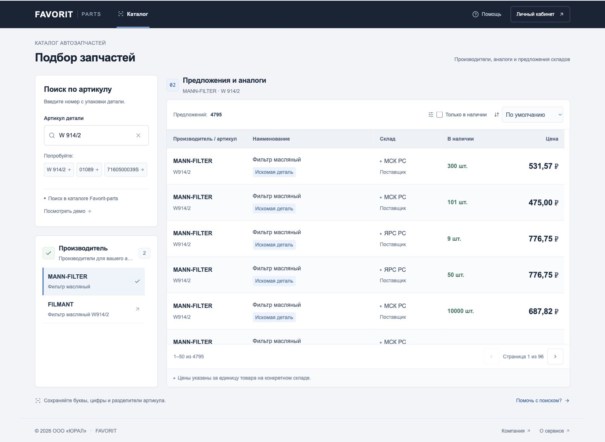

# FAVORIT · Подбор автозапчастей

Тестовое приложение для ООО «ЮРАЛ» (Favorit-parts). React, JavaScript, Redux Toolkit, адаптивная CSS-вёрстка. Без TypeScript, в соответствии с заданием.



## Запуск

Требуется Node.js 22.12+ и npm.

```sh
npm ci
npm run dev
```

Открыть http://127.0.0.1:5180. Vite перенаправляет `/api` на локальный Express-сервер (3001). По умолчанию включён реальный каталог. Для запросов нужен `FAVORIT_API_KEY` в `.env`. Без ключа можно вручную нажать небольшую кнопку «Посмотреть демо» внизу блока поиска.

```sh
npm test
npm run test:e2e
npm run build
npm start
```

Перед первым запуском браузерных тестов: `npx playwright install chromium`. Production-сборка обслуживается Express по адресу http://127.0.0.1:3001. Для публикации нужен Node.js-сервер; одного статического хостинга недостаточно. Приложение по умолчанию слушает только loopback.

## Два этапа поиска

1. После ввода артикула с задержкой 500 мс запрашивается список производителей. Выберите бренд.
2. Повторный запрос с артикулом, брендом и `analogues=on` возвращает деталь и аналоги. Предложения разворачиваются по складам: производитель, артикул, название, склад, цена и остаток.

Можно сортировать по цене и остатку и показывать только доступные позиции. Цены берутся **из `warehouses[].price`**, а не из устаревшего `goods[].price`. Без складов цена не выдумывается. Есть обработка пустых ответов, нулевого остатка, ошибок API, таймаута и отмены запросов. Запоздавшие ответы после смены артикула или бренда игнорируются.

## Подключение реального API

Получите ключ покупателя у представителя компании, который выдал задание. Скопируйте `.env.example` в `.env`, заполните `FAVORIT_API_KEY`, перезапустите сервер. Реальный API включён по умолчанию; дополнительное переключение не требуется.

Ключ хранится только на сервере. `.env` игнорируется Git; в браузер ключ и необработанные ошибки провайдера не возвращаются. Сервер обращается к фиксированному HTTPS-адресу `https://api.favorit-parts.ru/hs/hsprice/`, передавая параметры через Axios. В PDF приведён HTTP-адрес; HTTPS выбран для защиты ключа при передаче. Запрос без ключа к HTTPS во время разработки вернул 403 от защитного шлюза. 19.10.2026 проверен ключ из примеров документации: оба этапа по HTTPS вернули HTTP 200, обработчик приложения успешно разобрал реальный ответ. Ключ настраивается в локальном `.env`; в репозитории он не сохраняется. Доступность с целевого сервера и срок действия ключа требуют отдельной проверки. Автоматического отката к незашифрованному HTTP нет.

Контракт проверяется Zod. Документация: https://lk.favorit-parts.ru/static/wsprice.pdf. Пустой результат `goods: [{}]` преобразуется в пустой список. Ошибка `error` от внешнего API превращается в понятное сообщение клиенту.

**Демоданные вымышлены и не показывают реальные цены или наличие.** Любой непустой артикул даёт учебный набор масляных фильтров. Артикул `empty` демонстрирует отсутствие результатов. Ошибки реального API не подменяются демоданными. Учебные данные доступны только после явного нажатия «Посмотреть демо»; кнопка «Вернуться к каталогу» включает реальную выдачу. После перезагрузки страницы снова открывается реальный каталог.

## Структура

- `src/entities/parts` — API-клиент, преобразование данных, презентационные компоненты.
- `src/features/parts/searchParts` — сценарий поиска, Redux-состояние и локальный UI.
- `src/shared/ui` — общий компонент состояния загрузки/ошибки/пустого ответа.
- `src/app` — сборка приложения и стили.
- `server` — прокси к API и проверка контракта.
- `tests` — браузерные проверки основного сценария и мобильной компоновки.

Redux Toolkit используется для состояния двухэтапного поиска. Стейт фильтра и сортировки локален для таблицы. Здесь намеренно нет корзины, авторизации, вымышленных сроков доставки и других сценариев за пределами задания. Иконки — Lucide, шрифт — Golos Text из локального пакета с системным fallback и `font-display: optional`. Внешних запросов к Google Fonts нет. Сервер сжимает ресурсы и ответы API.

## Проверки

Unit-тесты проверяют цены складов, вложенные аналоги, дедупликацию, гонки ответов, валидацию и защиту ключа при ошибке. Playwright проверяет оба этапа поиска, фильтрацию, сортировку, сброс, пустую выдачу, отсутствие ключа и горизонтальное переполнение мобильного экрана.

Сопроводительное: [COVER_LETTER.md](./COVER_LETTER.md).

## Стабильность интерфейса и Core Web Vitals

Под производителей и предложения зарезервированы постоянные области: переходы между загрузкой, ошибкой, пустой выдачей и результатами не сдвигают соседние разделы. Список производителей и таблица прокручиваются внутри этих областей. При 320 px предложения отображаются карточками; цена и наличие видны без горизонтальной прокрутки. Очень длинные наименования переносятся и ограничиваются по высоте (полный текст доступен через `title`).

Выдача разбивается на страницы по 50 складских предложений. Фильтры и сортировка работают со всем набором, возвращают к первой странице и прокручивают только список. Тысячи React-строк одновременно не создаются.

```sh
npm run test:vitals
```

Команда собирает production-версию и запускает Chromium с официальной библиотекой `web-vitals`: CPU ×4, сеть 1,6 Мбит/с и RTT 150 мс, ширины 1440, 768, 390 и 320 px. API заменяется детерминированной задержанной выдачей из 7000 предложений, включая длинные строки и нулевые остатки. Проверяются CLS ≤ 0,1, LCP ≤ 2500 мс, INP ≤ 200 мс, отсутствие горизонтального переполнения и максимум 50 строк в DOM. Сценарий включает загрузку, смену состояний, сортировку, фильтр, пагинацию, пустой ответ и ошибку.

Результаты: [исходный замер](docs/vitals-before.json) и [финальный замер](docs/vitals-lab.json). Это локальный лабораторный замер по взаимодействиям, не полевые p75 и не оценка PageSpeed Insights. Результаты на другом устройстве могут отличаться. Полевую оценку нужно собирать после размещения и появления реального трафика.

## Адаптивная вёрстка и стили

- От 1400 px — таблица предложений, от 768 до 1399 px — карточки в две колонки, до 767 px — карточки в одну колонку. Переключение сохраняет читаемый размер данных без сжатия шрифта.
- Контролы для касания имеют область до 44 px, поле артикула использует 16 px для предотвращения автоматического увеличения на iOS. Длинные артикулы и названия переносятся внутри карточки.
- Стили каждого компонента лежат рядом в `.module.scss`; глобальные стили в `src/app/global.scss` содержат только шрифты, переменные, document defaults и focus/reset. Брейкпоинты общие: `src/shared/styles/_breakpoints.scss`.
- Алиас `@/` указывает на `src` в Vite, Vitest, Sass и редакторе (`jsconfig.json`). Импорты собственного соседнего SCSS-модуля остаются локальными. Для Node-сервера и сценария измерений используется нативный package alias `#src/`, определённый в `package.json`, без загрузчика или сборки сервера. Импортов с переходами `../` между модулями приложения нет.

Браузерные проверки охватывают 320, 360, 390, 480, 600, 768, 820, 1024, 1280 и 1920 px, touch-взаимодействия, длинные строки и цены до миллионов рублей. Превью: [телефон](docs/mobile.png), [планшет](docs/tablet.png). Проверки Chromium подтверждают компоновку на этих размерах; отдельная проверка на реальных iOS/Safari-устройствах не проводилась.

## Дизайн рабочего приложения

Интерфейс оформлен как строгая B2B-платформа подбора: графитовая шапка, белые рабочие поверхности, сдержанные синие акценты, единые рамки и отступы. Производители отображаются списком с выделением выбранного бренда; таблица использует контрастные заголовки, чередование строк и отдельную типографику цен. Декоративные монограммы и лишняя вложенность панелей убраны.

На экранах от 1100 px поиск и список производителей находятся в левой колонке, выдача занимает основную область справа. На планшетах и телефонах секции последовательно складываются в одну колонку, а предложения переходят в карточки. Все бренды доступны в прокручиваемом списке; все предложения — через пагинацию.

По умолчанию работает реальный каталог. Учебный режим включается только вручную через «Посмотреть демо».

Браузерные тесты используют явные фикстуры и не требуют ключа или запросов к внешнему API. Отдельно проверены реальный режим по умолчанию, ручное включение демо и отсутствие автоматической подмены данных при ошибке.

## Читаемость

Основной текст и производители — 16 px, подписи, артикулы и второстепенные данные — от 14 px, цены — 20–22 px. Мобильные правила не уменьшают эти размеры. Увеличены межстрочные интервалы, высота строк и карточек, ширина панели поиска и контраст приглушённого текста. Если фильтры или навигация не помещаются в строку, они переносятся, сохраняя размер шрифта.
